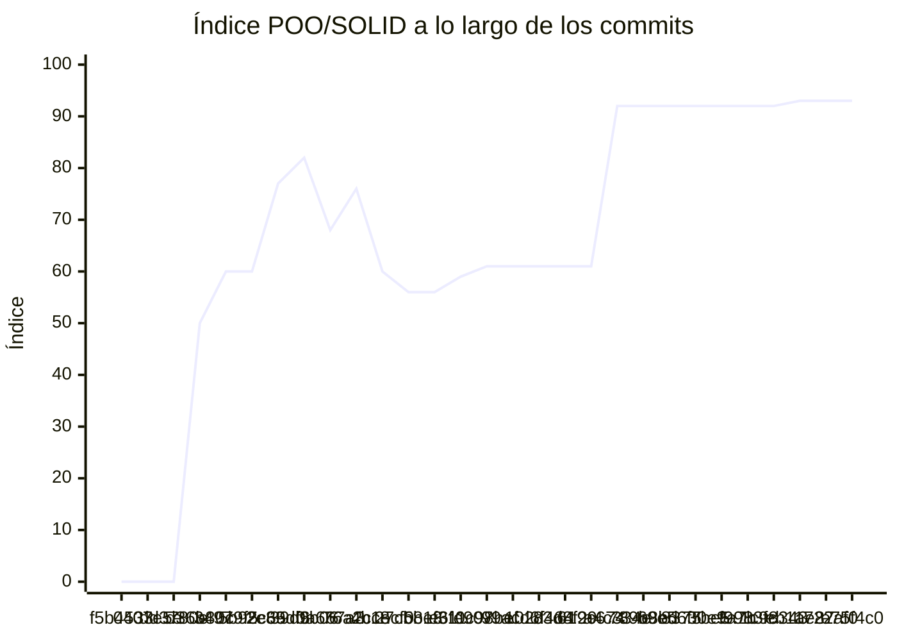

<!-- evaluacion:inicio -->
# Evaluación — salamin-noceti/proyecto-fisica--Tiro-Oblicuo

> Documento **generado automáticamente** por la cátedra de Programación II (RepoSense + análisis de calidad POO/SOLID). **No editar a mano**: se regenera en cada evaluación.
> Rama evaluada: `main`. Análisis **heurístico** (regex + métricas): es una criba para orientar la revisión, **no una nota**.
> Generado: 2026-11-20.

## 1. Veredicto

| Aspecto | Resultado |
|---|---|
| Índice de calidad POO/SOLID | **93/100** |
| Código (LOC) | 6,302 |
| Archivos de código | 118 |
| Clases (bien usadas) | 116 (99 OK) |
| Código dentro de clases (%POO) | 99% |
| Funciones fuera de clases | 0 |
| Duplicación lógica | 1.8% |
| Señales S/O/L/I/D | 1/0/0/0/5 |

> Este informe **describe** lo que el análisis midió con los criterios ya establecidos de la materia. No es una nota.

### Semáforo de aprobación

Criterios de `CRITERIOS-CALIDAD.md`. **Aprobar** se juega con el perfil `estandar`; **destacar**, con el `exigente` (meta de excelencia).

| Semáforo | Resultado |
|---|---|
| Aprobar (`estandar`) | **cumple** — 4/4 |
| Destacar (`exigente`) | **no cumple** — 4/5 |

**Criterios para aprobar**

| Criterio | Requisito | Tu resultado | Cumple |
|---|---|---|---|
| Código dentro de clases (%POO) | ≥ 85% | 99% | sí |
| Duplicación lógica | ≤ 10% | 1.8% | sí |
| Funciones fuera de clases | ≤ 1 | 0 | sí |
| Señales POO/SOLID críticas | ninguna | ninguna | sí |

**Criterios para destacar**

| Criterio | Requisito | Tu resultado | Cumple |
|---|---|---|---|
| Código dentro de clases (%POO) | ≥ 95% | 99% | sí |
| Duplicación lógica | ≤ 5% | 1.8% | sí |
| Funciones fuera de clases | ≤ 1 | 0 | sí |
| Señales POO/SOLID críticas | ninguna | Baja cohesión (LCOM), Acoplamiento alto (CBO) | no |
| Índice de calidad POO/SOLID | ≥ 60 | 93/100 | sí |

### Cómo se calcula el %POO (y por qué no sube solo)

`%POO = líneas de lógica dentro de clases ÷ líneas de lógica totales`.

Se cuentan las líneas de **lógica y campos**; no cuentan `package`/`import`/`using`/anotaciones ni comentarios, Javadoc o docstrings. Es una **proporción**: si agregás código nuevo dentro de una clase, el numerador y el denominador crecen juntos y el porcentaje casi no cambia.

Sube cuando el código que hoy está **fuera** de clases pasa a ser método de una clase (o desaparece): funciones sueltas, `main`, constantes de módulo, scripts y lógica de archivos sueltos. También importa que ese trabajo esté **integrado en `main`**: la evaluación siempre mide `main`, así que lo que sigue en otra rama no se refleja todavía.

## 2. Autoría (RepoSense)

| Autor | Commits | Código (LOC) | Tests (LOC) | Docs (LOC) | Días activos | % del código |
|---|---:|---:|---:|---:|---:|---:|
| avsalomon | 16 | 5,503 | 1,704 | 51 | 13 | 100% |
| Romano-22 | 7 | 0 | 14 | 0 | 5 | 0% |

> _El LOC de autoría lo calcula RepoSense sobre el historial y puede diferir del LOC de código del análisis de calidad (que mira solo el estado de `main`)._

> **Reparto del trabajo:** avsalomon concentra el 100% de las líneas de código. Un reparto muy desigual suele indicar que la integración no fue realmente en equipo; vale la pena reconstruir cómo se coordinó.

## 3. Fallas detectadas

Reúne lo que el análisis marcó y lo que todavía falta para cada semáforo. Cuando la señal se puede asociar a archivos, se indican para orientar la revisión. No es una nota.

| Falla | Tu resultado | Requisito | Archivos |
|---|---|---|---|
| Señales POO/SOLID críticas | Baja cohesión (LCOM), Acoplamiento alto (CBO) | Destacar: ninguna | `app/src/main/kotlin/org/example/state/AppState.kt`, `app/src/main/kotlin/org/example/ui/practica/componentes/ConstructorVistaPractica.kt`, `app/src/main/kotlin/org/example/ui/simulacion/ControladorSimulacion.kt`, `app/src/main/kotlin/org/example/ui/simulacion/LienzoSimulacion2D.kt`, `app/src/main/kotlin/org/example/ui/simulacion/RenderizadorCapasLienzo2D.kt`, `app/src/main/kotlin/org/example/ui/simulacion/graficos/CartesianChartCanvas.kt` |

## 4. Aspectos evaluados

Cada aspecto indica **qué mide**, **por qué importa** y **tu resultado**. Cuando el análisis reportó una señal, se agregan preguntas para **investigar la causa** (no hay recetas: entender el porqué es parte de la evaluación).

### 1. Índice de calidad POO/SOLID (indice)

- **Qué mide:** Un resumen numérico (0-100) que combina la riqueza de clases bien usadas con la penalización por señales POO/SOLID y duplicación, y luego aplica topes duros.
- **Por qué importa:** Ordena y prioriza la revisión: un índice bajo indica varias señales que conviene mirar juntas.
- **Tu resultado:** índice **93/100**

### 2. Duplicación lógica (DRY) (duplicacion) — sin señales

- **Qué mide:** Porcentaje de bloques de LÓGICA repetidos. Quedan fuera imports/includes, anotaciones, declaraciones de campos y comentarios/Javadoc/docstrings: esos bloques son boilerplate, no lógica.
- **Por qué importa:** Cada copia de lógica se mantiene por separado: un arreglo hay que repetirlo y los defectos se multiplican.
- **Tu resultado:** **1.8%** de duplicación lógica

### 3. Adopción de POO (% de código en clases) (poo) — sin señales

- **Qué mide:** Proporción de las **líneas de lógica** que viven dentro de una clase. Quedan fuera `package`/`import`/`using`/anotaciones y comentarios/Javadoc/docstrings: no son código que pueda estar dentro de una clase y, si contaran, el porcentaje quedaría topado por el boilerplate de cada archivo.
- **Por qué importa:** El diseño orientado a objetos es el eje de la materia: el comportamiento debería vivir como método de una clase.
- **Tu resultado:** **99.1%** del código dentro de clases
- **Cómo leerlo:** Es una **proporción**, no un acumulado: agregar código dentro de una clase no la sube por sí solo (numerador y denominador crecen juntos). Sube cuando el código que está **fuera** de clases (funciones sueltas, `main`, constantes de módulo, scripts) pasa a ser método de una clase o deja de existir. La medición se hace sobre `main`: el trabajo que todavía vive en otra rama no se refleja hasta que se integra.

### 4. Funciones fuera de clases (sueltas) — sin señales

- **Qué mide:** Funciones de nivel de módulo que no pertenecen a ninguna clase (en esta materia el comportamiento debe ser método de una clase).
- **Por qué importa:** Son la forma más directa de código procedural en un proyecto que debería ser orientado a objetos.
- **Tu resultado:** **0** función(es) fuera de clases

### 5. Clase demasiado grande (SRP) (god) — sin señales

- **Qué mide:** Clases con demasiadas líneas o métodos de LÓGICA. No cuentan los getters/setters triviales ni la cantidad de campos por sí sola.
- **Por qué importa:** Una clase que hace de todo cambia por muchos motivos y cuesta entenderla y probarla.
- **Tu resultado:** **0** clase(s) demasiado grande(s)

### 6. Baja cohesión (LCOM) (cohesion) — con señales

- **Qué mide:** Métodos y campos de una clase que casi no se relacionan entre sí.
- **Por qué importa:** Una unidad que cambia por motivos distintos y comparte poca información suele esconder más de una responsabilidad.
- **Tu resultado:** **1** clase(s) con baja cohesión
- **Para investigar la causa:**
    - ¿Qué métodos de la clase no comparten estado con el resto?
    - ¿Cambian por motivos distintos según la tarea?
    - ¿Se pensó su responsabilidad antes de escribirla, o se fue agregando?

### 7. Complejidad alta (complejidad) — sin señales

- **Qué mide:** Complejidad ciclomática: cantidad de caminos posibles dentro de un método o función (condicionales, bucles, casos).
- **Por qué importa:** Muchos caminos = difícil de seguir y de probar; suelen esconderse casos sin cubrir.
- **Tu resultado:** **0** método(s)/función(es) con complejidad alta

### 8. Métodos/funciones largos o con muchos parámetros (tamano) — sin señales

- **Qué mide:** Tamaño de los métodos/funciones y cantidad de parámetros.
- **Por qué importa:** Una función que hace varias cosas cuesta leerla, nombrarla y reutilizarla.
- **Tu resultado:** **0** método(s)/función(es) largos o con muchos parámetros

### 9. Acoplamiento alto (CBO) (acoplamiento) — con señales

- **Qué mide:** Cuánto depende una clase de otros tipos del proyecto. No cuentan los tipos de la plataforma (biblioteca estándar, DOM, motor Godot) ni los métodos/propiedades propias.
- **Por qué importa:** Piezas muy enlazadas hacen que un cambio se propague y que sea difícil reemplazar partes.
- **Tu resultado:** **5** clase(s) muy acoplada(s)
- **Para investigar la causa:**
    - ¿La clase conoce detalles internos de muchas otras?
    - ¿Se puede cambiar una parte sin tocar las demás?
    - ¿Los colaboradores llegan como parámetros o se crean por dentro?

### 10. Herencia profunda (DIT) (herencia) — sin señales

- **Qué mide:** Profundidad de la cadena de herencia de una clase.
- **Por qué importa:** Jerarquías muy profundas vuelven difícil saber de dónde viene cada comportamiento.
- **Tu resultado:** **0** clase(s) con herencia profunda

### 11. Switch sobre tipos (OCP) (ocp) — sin señales

- **Qué mide:** Cadenas de dispatch por tipo (`else if ... is` / `else if ... instanceof`, `switch` sobre tipo o `typeof`). Un `is Tipo variable` aislado (pattern matching / cast seguro) NO cuenta como switch.
- **Por qué importa:** Cada tipo nuevo obliga a tocar varios lugares, en vez de extender con una implementación nueva.
- **Tu resultado:** **0** clase(s) con switch sobre tipos

### 12. Interfaz con demasiados métodos (ISP) (isp) — sin señales

- **Qué mide:** Interfaces o clases abstractas con muchos métodos declarados.
- **Por qué importa:** Obliga a implementar operaciones que no se usan y acopla a los clientes a métodos que no necesitan.
- **Tu resultado:** **0** interfaz(es) con demasiados métodos

### 13. Override vacío o 'no implementado' (LSP) (lsp) — sin señales

- **Qué mide:** Métodos sobrescritos que quedan vacíos o lanzan 'no implementado'.
- **Por qué importa:** Suele indicar que la jerarquía no representa bien el problema y rompe la sustitución entre clases.
- **Tu resultado:** **0** override(s) vacío(s) o 'no implementado'

### 14. Clase sin métodos (solo datos) (data) — sin señales

- **Qué mide:** Clases que solo acumulan campos y no tienen comportamiento.
- **Por qué importa:** Separar datos de comportamiento reparte por el proyecto la lógica que debería estar cerca de esos datos.
- **Tu resultado:** **0** clase(s) sin métodos (solo datos)

### 15. Campos mutables públicos (encapsulación) (encapsulacion) — sin señales

- **Qué mide:** Clases que exponen estado **modificable** desde afuera. No cuentan constantes (`static final`, `const`), campos `final`/`readonly`, propiedades `val` de Kotlin ni propiedades con `private set`.
- **Por qué importa:** Expone el estado interno y hace que cualquier cambio dependa de quién lo modifica desde afuera.
- **Tu resultado:** **0** clase(s) con campos mutables públicos

### 16. Clase solo con métodos estáticos (utilitaria) (static) — sin señales

- **Qué mide:** Clases donde todos los métodos son estáticos.
- **Por qué importa:** Es comportamiento procedural disfrazado de clase: no se instancia ni participa del modelo de objetos.
- **Tu resultado:** **0** clase(s) solo con métodos estáticos

### Archivos donde se originan las señales

> Se listan **12** hallazgo(s) localizados en **8** archivo(s). La columna `Línea` es la línea del archivo donde el análisis detectó la señal; `—` indica una señal de nivel repositorio (sin archivo propio).

| Aspecto | Archivo | Línea | Hallazgo |
|---|---|---:|---|
| Duplicación lógica (DRY) | — | — | duplicación lógica: 1.8% · boilerplate: 6.9% |
| Duplicación lógica (DRY) | `app/src/main/kotlin/org/example/service/ImpresoraMenuConsola.kt` | 19 | bloque de 8 líneas repetido 5 veces en app/src/main/kotlin/org/example/service/ImpresoraMenuConsola.kt:19, app/src/main/kotlin/org/example/service/ImpresoraMenuConsola.kt:20, app/src/main/kotlin/org/example/service/SimulacionConsoleRunner.kt:30 |
| Duplicación lógica (DRY) | `app/src/main/kotlin/org/example/service/ImpresoraMenuConsola.kt` | 21 | bloque de 8 líneas repetido 3 veces en app/src/main/kotlin/org/example/service/ImpresoraMenuConsola.kt:21, app/src/main/kotlin/org/example/service/SimulacionConsoleRunner.kt:33, app/src/main/kotlin/org/example/ui/FormateadorConsolaEjercicio.kt:26 |
| Duplicación lógica (DRY) | `app/src/main/kotlin/org/example/ui/simulacion/EdificioThemeRenderer.kt` | 118 | bloque de 8 líneas repetido 2 veces en app/src/main/kotlin/org/example/ui/simulacion/EdificioThemeRenderer.kt:118, app/src/main/kotlin/org/example/ui/simulacion/CanonThemeRenderer.kt:74 |
| Duplicación lógica (DRY) | `app/src/main/kotlin/org/example/ui/simulacion/EdificioThemeRenderer.kt` | 121 | bloque de 8 líneas repetido 2 veces en app/src/main/kotlin/org/example/ui/simulacion/EdificioThemeRenderer.kt:121, app/src/main/kotlin/org/example/ui/simulacion/CanonThemeRenderer.kt:77 |
| Duplicación lógica (DRY) | `app/src/main/kotlin/org/example/ui/simulacion/EdificioThemeRenderer.kt` | 128 | bloque de 8 líneas repetido 2 veces en app/src/main/kotlin/org/example/ui/simulacion/EdificioThemeRenderer.kt:128, app/src/main/kotlin/org/example/ui/simulacion/CanonThemeRenderer.kt:84 |
| Baja cohesión (LCOM) | `app/src/main/kotlin/org/example/state/AppState.kt` | 12 | clase 'AppState' con baja cohesión (43%) |
| Acoplamiento alto (CBO) | `app/src/main/kotlin/org/example/ui/practica/componentes/ConstructorVistaPractica.kt` | 29 | clase 'ConstructorVistaPractica' muy acoplada (CBO=8) |
| Acoplamiento alto (CBO) | `app/src/main/kotlin/org/example/ui/simulacion/ControladorSimulacion.kt` | 12 | clase 'ControladorSimulacion' muy acoplada (CBO=8) |
| Acoplamiento alto (CBO) | `app/src/main/kotlin/org/example/ui/simulacion/LienzoSimulacion2D.kt` | 12 | clase 'LienzoSimulacion2D' muy acoplada (CBO=9) |
| Acoplamiento alto (CBO) | `app/src/main/kotlin/org/example/ui/simulacion/RenderizadorCapasLienzo2D.kt` | 16 | clase 'RenderizadorCapasLienzo2D' muy acoplada (CBO=8) |
| Acoplamiento alto (CBO) | `app/src/main/kotlin/org/example/ui/simulacion/graficos/CartesianChartCanvas.kt` | 14 | clase 'CartesianChartCanvas' muy acoplada (CBO=8) |

### Desglose de la columna S (SRP)

> La columna **S** no es un puntaje: cuenta **señales** de SRP. Aquí suma **1** entrada(s) sobre **1** clase(s) distinta(s).

| Señal | Entradas | Regla (perfil exigente) |
|---|---:|---|
| Cohesión baja | 1 | < 50 % de los pares de métodos comparten algún campo (con ≥ 4 métodos con lógica y ≥ 3 campos). |

**Clases con baja cohesión (1)**

- `AppState`: cohesión baja (43% de pares comparten campos)

> El análisis no excluye tests: una clase de test que supere los umbrales también suma.

## 5. Evolución por commit

Métricas calculadas sobre el estado de `main` en **cada commit** (29 commits con trabajo), del primero al último. La calidad usa el perfil `exigente`; el aporte de código lo mide RepoSense. El índice puede **bajar** al crecer el proyecto: se acumulan señales.

| # | Fecha | Commit | Autor | LOC | Índice | %POO | Duplic. | Sueltas |
|---|---|---|---|---:|---:|---:|---:|---:|
| 1 | 2026-08-14 | `f5b4533` | Romano-22 | 0 | 0 | 0% | 0.0% | 0 |
| 2 | 2026-08-14 | `0407e5e` | Romano-22 | 0 | 0 | 0% | 0.0% | 0 |
| 3 | 2026-08-28 | `dd3780e` | dqmdz-etec | 0 | 0 | 0% | 0.0% | 0 |
| 4 | 2026-08-28 | `d36b80c` | avsalomon | 65 | 50 | 15% | 0.0% | 0 |
| 5 | 2026-09-04 | `34979f5` | avsalomon | 133 | 60 | 54% | 0.0% | 0 |
| 6 | 2026-09-07 | `5b92c65` | Romano-22 | 215 | 60 | 54% | 0.0% | 0 |
| 7 | 2026-10-02 | `2e89df6` | Romano-22 | 277 | 77 | 77% | 0.0% | 0 |
| 8 | 2026-10-05 | `39d9b06` | avsalomon | 638 | 82 | 87% | 0.0% | 0 |
| 9 | 2026-10-09 | `0a667a3` | avsalomon | 1,443 | 68 | 93% | 12.0% | 0 |
| 10 | 2026-10-16 | `76a2cc8` | avsalomon | 3,076 | 76 | 96% | 6.2% | 0 |
| 11 | 2026-10-16 | `4b1ecf0` | avsalomon | 5,634 | 60 | 98% | 9.9% | 0 |
| 12 | 2026-10-19 | `27cb813` | avsalomon | 5,927 | 56 | 98% | 10.2% | 0 |
| 13 | 2026-10-26 | `5bef311` | avsalomon | 7,177 | 56 | 98% | 9.3% | 0 |
| 14 | 2026-10-30 | `e6fe907` | avsalomon | 8,435 | 59 | 98% | 8.2% | 0 |
| 15 | 2026-11-06 | `0c98bef` | avsalomon | 8,525 | 61 | 99% | 8.0% | 0 |
| 16 | 2026-11-07 | `99acd6f` | dqmdz-etec | 8,525 | 61 | 99% | 8.0% | 0 |
| 17 | 2026-11-07 | `102d464` | dqmdz-etec | 8,525 | 61 | 99% | 8.0% | 0 |
| 18 | 2026-11-07 | `83d8f29` | dqmdz-etec | 8,525 | 61 | 99% | 8.0% | 0 |
| 19 | 2026-11-07 | `619c674` | dqmdz-etec | 8,525 | 61 | 99% | 8.0% | 0 |
| 20 | 2026-11-13 | `a4c334e` | avsalomon | 6,308 | 92 | 99% | 1.8% | 0 |
| 21 | 2026-11-13 | `789b8bd` | dqmdz-etec | 6,308 | 92 | 99% | 1.8% | 0 |
| 22 | 2026-11-14 | `69e56f5` | dqmdz-etec | 6,308 | 92 | 99% | 1.8% | 0 |
| 23 | 2026-11-16 | `8377be5` | dqmdz-etec | 6,308 | 92 | 99% | 1.8% | 0 |
| 24 | 2026-11-17 | `30e9a7b` | dqmdz-etec | 6,308 | 92 | 99% | 1.8% | 0 |
| 25 | 2026-11-19 | `f9983fc` | dqmdz-etec | 6,308 | 92 | 99% | 1.8% | 0 |
| 26 | 2026-11-20 | `1c98343` | dqmdz-etec | 6,308 | 92 | 99% | 1.8% | 0 |
| 27 | 2026-11-20 | `eb1ae87` | dqmdz-etec | 6,302 | 93 | 99% | 1.8% | 0 |
| 28 | 2026-11-20 | `1722af0` | dqmdz-etec | 6,302 | 93 | 99% | 1.8% | 0 |
| 29 | 2026-11-20 | `e75f4c0` | dqmdz-etec | 6,302 | 93 | 99% | 1.8% | 0 |

<!-- actividad-clases:inicio -->
## Actividad en días de clase

> Período evaluado **2026-08-14 → 2026-11-20** · **23 clases** (lunes, viernes) · días de clase del calendario, extendidos hasta la fecha de corte.
>
> `Commits` = commits de trabajo (no-merge); `Merges` = merges de PR (también son push). Los días sin actividad dicen **sin actividad**. El cuadro principal usa sólo las fechas de clase del calendario oficial.
>
> **Aportes fuera del calendario:** cada alumno tiene un cuadro aparte con las fechas no lectivas con actividad, desde **2026-08-14** hasta **2026-11-20** (ventana de aportes). Esas fechas no forman parte del cuadro principal, pero se muestran para no perder trabajo hecho en fines de semana, feriados o después del período.
>
> Se recorre `git log --all` sobre un mirror (todas las ramas y `refs/pull/*`), con deduplicación por commit. Fecha = fecha de autor en UTC-3. Los commits locales no pusheados no se ven. Si el trabajo fue en pareja y el commit es de otra persona, figura a nombre del autor del commit; para reflejarlo, usar `Co-authored-by` o una nota manual.
>
> Sección informativa: no modifica el semáforo de aprobación.

### avsalomon

**13/23 clases con actividad** · 17 commits · 17 merges

| Fecha | Marca | Repositorios | Commits / merges |
|---|:--:|---|--:|
| 2026-08-14 | No | sin actividad | 0 / 0 |
| 2026-08-21 | No | sin actividad | 0 / 0 |
| 2026-08-24 | No | sin actividad | 0 / 0 |
| 2026-08-28 | **Sí** | proyecto-fisica--Tiro-Oblicuo | 1 / 1 |
| 2026-08-31 | No | sin actividad | 0 / 0 |
| 2026-09-04 | **Sí** | proyecto-fisica--Tiro-Oblicuo | 1 / 2 |
| 2026-09-07 | No | sin actividad | 0 / 0 |
| 2026-09-14 | No | sin actividad | 0 / 0 |
| 2026-09-25 | No | sin actividad | 0 / 0 |
| 2026-09-28 | No | sin actividad | 0 / 0 |
| 2026-10-02 | **Sí** | proyecto-fisica--Tiro-Oblicuo | 1 / 0 |
| 2026-10-05 | **Sí** | proyecto-fisica--Tiro-Oblicuo | 1 / 2 |
| 2026-10-09 | **Sí** | proyecto-fisica--Tiro-Oblicuo | 3 / 3 |
| 2026-10-16 | **Sí** | proyecto-fisica--Tiro-Oblicuo | 2 / 3 |
| 2026-10-19 | **Sí** | proyecto-fisica--Tiro-Oblicuo | 1 / 1 |
| 2026-10-23 | **Sí** | proyecto-fisica--Tiro-Oblicuo | 2 / 1 |
| 2026-10-26 | **Sí** | proyecto-fisica--Tiro-Oblicuo | 0 / 1 |
| 2026-10-30 | **Sí** | proyecto-fisica--Tiro-Oblicuo | 1 / 1 |
| 2026-11-02 | No | sin actividad | 0 / 0 |
| 2026-11-06 | **Sí** | proyecto-fisica--Tiro-Oblicuo | 1 / 1 |
| 2026-11-13 | **Sí** | proyecto-fisica--Tiro-Oblicuo | 1 / 1 |
| 2026-11-16 | No | sin actividad | 0 / 0 |
| 2026-11-20 | **Sí** | proyecto-fisica--Tiro-Oblicuo | 2 / 0 |

#### Aportes fuera del calendario de clases — avsalomon

_Sin aportes fuera del calendario de clases para avsalomon._

### Romano-22

**5/23 clases con actividad** · 12 commits · 5 merges

| Fecha | Marca | Repositorios | Commits / merges |
|---|:--:|---|--:|
| 2026-08-14 | **Sí** | proyecto-fisica--Tiro-Oblicuo | 4 / 1 |
| 2026-08-21 | No | sin actividad | 0 / 0 |
| 2026-08-24 | No | sin actividad | 0 / 0 |
| 2026-08-28 | No | sin actividad | 0 / 0 |
| 2026-08-31 | **Sí** | proyecto-fisica--Tiro-Oblicuo | 2 / 0 |
| 2026-09-04 | **Sí** | proyecto-fisica--Tiro-Oblicuo | 4 / 2 |
| 2026-09-07 | **Sí** | proyecto-fisica--Tiro-Oblicuo | 1 / 1 |
| 2026-09-14 | No | sin actividad | 0 / 0 |
| 2026-09-25 | No | sin actividad | 0 / 0 |
| 2026-09-28 | No | sin actividad | 0 / 0 |
| 2026-10-02 | **Sí** | proyecto-fisica--Tiro-Oblicuo | 1 / 1 |
| 2026-10-05 | No | sin actividad | 0 / 0 |
| 2026-10-09 | No | sin actividad | 0 / 0 |
| 2026-10-16 | No | sin actividad | 0 / 0 |
| 2026-10-19 | No | sin actividad | 0 / 0 |
| 2026-10-23 | No | sin actividad | 0 / 0 |
| 2026-10-26 | No | sin actividad | 0 / 0 |
| 2026-10-30 | No | sin actividad | 0 / 0 |
| 2026-11-02 | No | sin actividad | 0 / 0 |
| 2026-11-06 | No | sin actividad | 0 / 0 |
| 2026-11-13 | No | sin actividad | 0 / 0 |
| 2026-11-16 | No | sin actividad | 0 / 0 |
| 2026-11-20 | No | sin actividad | 0 / 0 |

#### Aportes fuera del calendario de clases — Romano-22

_Sin aportes fuera del calendario de clases para Romano-22._

<!-- actividad-clases:fin -->

---
_Informe generado por la cátedra. Los criterios y umbrales de medición corresponden al perfil `exigente` de `calidad.py`; el semáforo de aprobación, a `CRITERIOS-CALIDAD.md` (ver `README.md`). Ante dudas, revisá el archivo señalado._
<!-- evaluacion:fin -->
